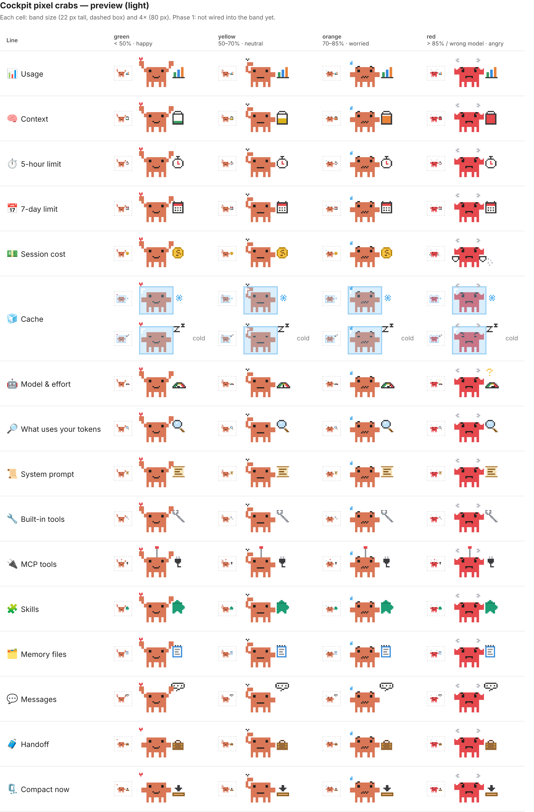
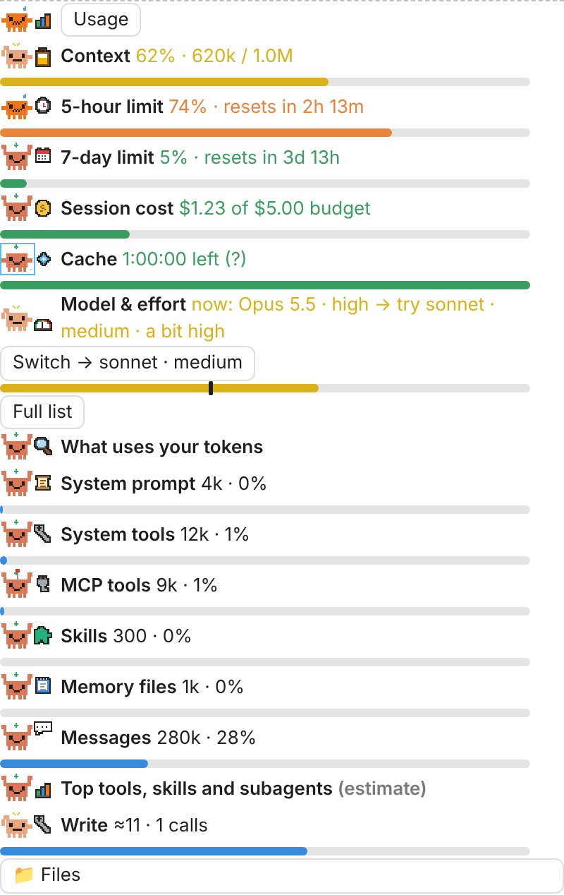

# cockpit

A usage cockpit for Claude Code: one band above the prompt and one panel that show what the session costs and how close it is to its limits, plus a free model/effort advisor, a budget guard, a `/handoff` command and a prompt-cache idle timer. A pixel crab shows the mood: calm, sweating at the warning level, alarm at the critical level, packing a suitcase during a handoff, holding a gauge for the advisor.

## Install

```
/plugin marketplace add Idriss-Mokdadi/claude-mods
/plugin install cockpit@claude-mods
```

## What it shows



On desktop and mobile every line carries a **pixel crab** holding the line's prop (backpack for context, stopwatch, calendar, coin, ice cube, gauge, scroll, wrench, plug, puzzle piece, notebook, speech bubble, suitcase, clamp). Its mood follows that line's own bar, by colour and by pose: **calm clay, happy** (green, under 50%), **light clay, scratching its head** (yellow, 50-70%), **vivid orange, sweating** (orange, 70-85%), **red, steaming, snapping** (red, over 85%, or a wrong model, with a "?"). A cold cache shows the crab asleep in a frosted ice cube. Animations stop under reduced motion. The terminal keeps text and emojis.

**Collapsed (default):** one small button: the `usage` crab in the worst mood of all lines, and the word Usage. Other mods' bands (the workspace Files button) sit beside it.


**Expanded** (press the button; press again to collapse; the choice is remembered across sessions): one item per line, each with its crab, the value and a progress bar: Context · 5-hour limit (reset time) · 7-day limit · Session cost (against a budget) · Cache (the bar drains as the TTL runs out, `m:ss left`) · Model & effort (current vs suggested, **Switch** on that line only). Then **What uses your tokens**: System prompt, System tools, MCP tools, Skills, Memory files, Messages, and the top 5 tools, skills and subagents (estimate). At the critical level, **Compact now** and **Handoff**; always, **Full list**.



Bar colours: green under 50%, yellow 50-70%, orange 70-85%, red over 85%.

**`/usage-panel`** shows the same lines (the only view on mobile, which has no band), plus **Show all** for every tool, MCP server, memory file and skill, and **Refresh**.

## Features

1. **Model and effort advisor.** A scored classifier, zero tokens, on the person's own prompts only (Enter at the prompt, Remote Control, the desktop app's host; never notifications, peer messages, slash commands, hidden prompts or engine-wrapped text). Signals in English, French and Arabic, matched by word stem so plurals and inflections count (bug/bugs, analyse/analysing/analysis):
   - complexity (complex, complicated, difficult, hard, tricky, advanced · complexe, difficile · معقد، صعب) and deep thinking (think deeply, ultrathink, in-depth · réfléchis en profondeur · فكر بعمق);
   - scope (app, project, codebase, architecture, whole/entire, many files, large), workload (a lot of, many, several · beaucoup de · الكثير من);
   - task type (bugs/errors/crash, stack traces, analysis/review/audit, refactor/migrate/design, security/performance/concurrency, build/implement, code);
   - intensifiers just before a signal (too, very, really, so · trop, très · جدا after it) add points;
   - down-signals: short/quick/brief, greetings, simple questions (what is, translate, define), small edits (typo, rename);
   - size: pasted code, long text, long documents.

   The score maps to six tiers: Haiku·low, Sonnet·low, Sonnet·medium, Sonnet·high, Opus·high, Opus·xhigh (xhigh only when deep thinking is asked on a strong score). A short follow-up ("yes", "ok do it", "continue", "next", "oui", "نعم") keeps the tier of the task it follows for up to 5 prompts; a clearly new small task ends it. The model line shows **why** (the top three reasons, in the UI language), for example `why: complex · many bugs · whole app`. The prompt text is never changed. Optional **AI check** (`advisorAi`, off by default): for a score in the middle band only, one Haiku call at low effort gives a second opinion; its cost shows on the line.
2. **Switch.** Sets the model through the `/config` model row, falls back to `/model`, then reads the session's model back; if it did not change, a toast says "Model not changed: pick <model> in the model menu". Effort is set with `/effort`.
3. **Active effort** is read from `CLAUDE_EFFORT`, the `/config` rows, the `effortLevel` setting, `CLAUDE_CODE_EFFORT_LEVEL`, each model request and the classic hooks, and again after `/effort` or `/model`.
4. **Budget guard.** Toast at the warning level (70%), Compact now and Handoff past the critical level (85%), over context and plan limits.
5. **`/handoff`.** One Haiku call at low effort writes `handoff/HANDOFF-<date-time>.md` (goal, decisions, open problems, next steps, files touched), then tells you to start a new session with `read handoff/<file>`. A basic note is written if the call fails.
6. **Cache keep-alive** (off by default), see Limits.

## Commands

| Command | Does |
| --- | --- |
| `/usage-panel` | Opens or closes the panel (`/usage-panel open` only opens it). |
| `/handoff` | Writes the handoff note. |

## Settings (`/config`)

| Setting | Default | Meaning |
| --- | --- | --- |
| `warnPercent` | 70 | Warning level, percent. |
| `criticalPercent` | 85 | Critical level, percent. |
| `costBudgetUsd` | 5 | The cost bar is full at this amount. |
| `advisor` | true | Show the model/effort advisor. |
| `advisorAi` | false | One Haiku check when the rule score is ambiguous (costs a little per check). |
| `cacheTtl` | auto | `auto`, `5m` or `1h`. |
| `keepAlive` | false | Ping the cache before it expires. |
| `keepAliveMaxPings` | 3 | Most pings between two of your turns. |
| `language` | auto | `en`, `fr` or `ar` (right to left). |
| `debug` | false | Log each submission's origin and length (`$.ui.log`). |

## Limits

- **Attribution is an estimate.** It counts characters in tool inputs and results that the main thread saw; a subagent's own context is not included.
- **TTL detection.** The engine reports the TTL only on a model switch. Before that, `auto` guesses 1 h on a subscription (rate limits reported) and 5 min otherwise, shown with a `?`.
- **Keep-alive** uses `$.model.fork` with no effort named and a "reply ok" prompt. It reads the main thread's cached prefix, which refreshes that cache entry. Each ping costs about one cache read of the whole context (shown in the band as `≈$x/ping`; for Opus 5.5 at 100k tokens about $0.02). The timer resets only when the ping's usage shows a cache read. A named low effort is avoided on purpose: on models without per-message effort it would write a second cache entry of the whole conversation.
- **Effort** is read from the turn's model requests and from classic hook inputs; before the first turn it is unknown unless `CLAUDE_EFFORT` or `CLAUDE_CODE_EFFORT_LEVEL` is set.
- **Switch**: a model switch drops the prompt cache. Whether the `/config` model row accepts a plugin's change on every host is not verified live; the read-back check reports it when it does not.
- **Compact now** works only while Claude is idle.
- The band's breakdown uses the free local estimate (`summary`); the panel's uses `full`, which sends token-count requests as `/context` does, only when it opens or you press Refresh.
- No network calls of its own, no processes. `/handoff` is the only file it writes.
