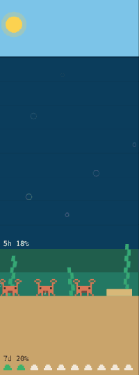
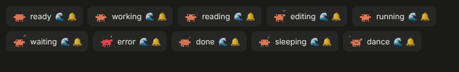
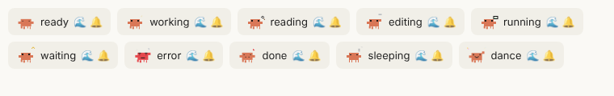

# companion

A crab companion for Claude Code. Hooks only: no model call, zero tokens, no network, no file written.



## What it does

1. **Lagoon backdrop** (desktop and mobile). Desktop draws it in a strip against the left edge of the window, where the session list sits; the rest stays plain. Mobile draws the same scene full screen under its veil.

   | In the Lagoon | Means |
   | --- | --- |
   | 10 water bands filling from the bottom (green, yellow, orange, red on the top two) | 5-hour limit, one band per started 10% |
   | 10 shells on the sand lighting up | 7-day limit |
   | Sun sinking to the moon, sky darkening | Prompt-cache age (time since the last turn against the TTL) |
   | Crabs falling asleep one by one; all asleep + night | Cache ageing; cache cold |
   | One pink jellyfish per subagent | Pulses while working, turns green and floats away when done, flickers red on failure |
   | Sandcastle, one level per done task, flag when all are done | Tasks (TodoWrite, TaskCreate, TaskUpdate) |
   | Crab digging / hammering / typing on a terminal / raising an antenna | Read, Grep, Glob / Edit, Write / Bash / web search and fetch |
   | Crab with a yellow "?" | A hard prompt (design, debugging, security, proofs; en, fr, ar) sent to a Haiku model |
   | Red angry crab with steam | A failed tool, a failed turn, or a limit at the critical level |
   | Crabs squeezing into a bucket, then popping out | Compaction |
   | A crab packing a suitcase and walking off | `/handoff` (cockpit's command) |
   | Fireworks and dancing crabs | A celebration |

2. **Mood crab band**: one crab and one word above the prompt: ready, working, reading, editing, running, waiting for you, error (or "limit 95%"), done, sleeping, party. Then 🌊 (Lagoon on/off) and 🔔 (sound on/off). One row; it never wraps when only one row is free. The terminal shows the text crab and its word only.

   
   

3. **Done alerts**: a toast and a short crab chirp when Claude finishes a turn that worked at least 30 s (setting), and when it waits for a permission or asks a question (at most one per 15 s).
4. **Celebrations**: all tasks done, tests passing after a failure, a successful `git commit`. Crab dance in the band, fireworks in the Lagoon, a happy chirp. At most one every 30 s.
5. English, French and Arabic (right to left). `prefers-reduced-motion` gets a still scene.

## Commands

- `/theme on|off|toggle`: the Lagoon. Other `/theme` uses go to Claude Code's own `/theme`. `/lagoon [on|off|toggle]` does the same and toggles with no argument.

The 🌊 and 🔔 choices are remembered across sessions.

## Settings

| Setting | Default | |
| --- | --- | --- |
| Lagoon backdrop | on | Start with the Lagoon |
| Lagoon strip width | 260 px | Width of the strip on desktop |
| Lagoon strip side | left | `right` if your session list is on the right |
| Glass blur / opacity | 12 / 0.55 | How the app's panels frost over the Lagoon; raise opacity if the session list is hard to read |
| Sound / Volume | on / 70% | Chirps |
| Done alert after | 30 s | Shortest turn that gets a done alert |
| Celebrations | on | |
| Critical limit | 90% | When the crab turns red for a limit |
| Prompt-cache TTL | auto | 1h on a subscription, 5m otherwise, or the TTL the engine reports |
| Language | auto | en, fr, ar |

## Limits

- Mods cannot see whether the left sidebar is open, so the strip is drawn either way: switch it with 🌊 or `/theme`.
- The engine does not say whether the window has focus, so alerts are not muted while you look at the window. Turn the sound off with 🔔.
- `$.audio.play` plays through `afplay` on macOS; a Linux or Windows terminal plays nothing.
- Only one theme stands per session: another mod's theme set later replaces the Lagoon, and turning the Lagoon off clears whatever theme stands.
- The confused crab is a rule-of-thumb: it only flags hard prompts on Haiku.
- Cache age is an estimate from the time since the last turn.

## Install

```
/plugin marketplace add Idriss-Mokdadi/claude-mods
/plugin install companion@claude-mods
```

## Development

- `claude plugin validate plugins/companion`, `tsc -p plugins/companion`, `claude plugin test plugins/companion`.
- The chirps in `assets/` are original, made by `node plugins/companion/tools/make-sounds.mjs`.
- Captures in `docs/`: `lagoon.gif`, `lagoon-states-1.png` (calm, reading, editing, running, web + 3 agents, agents done/failed, confused), `lagoon-states-2.png` (critical, compact, handoff, cache ageing, older, cold, all done), `lagoon-reduced-motion.png`, `lagoon-mobile.png`.

Crab art: see [THIRD_PARTY_NOTICES.md](THIRD_PARTY_NOTICES.md). Personal, private use only.
