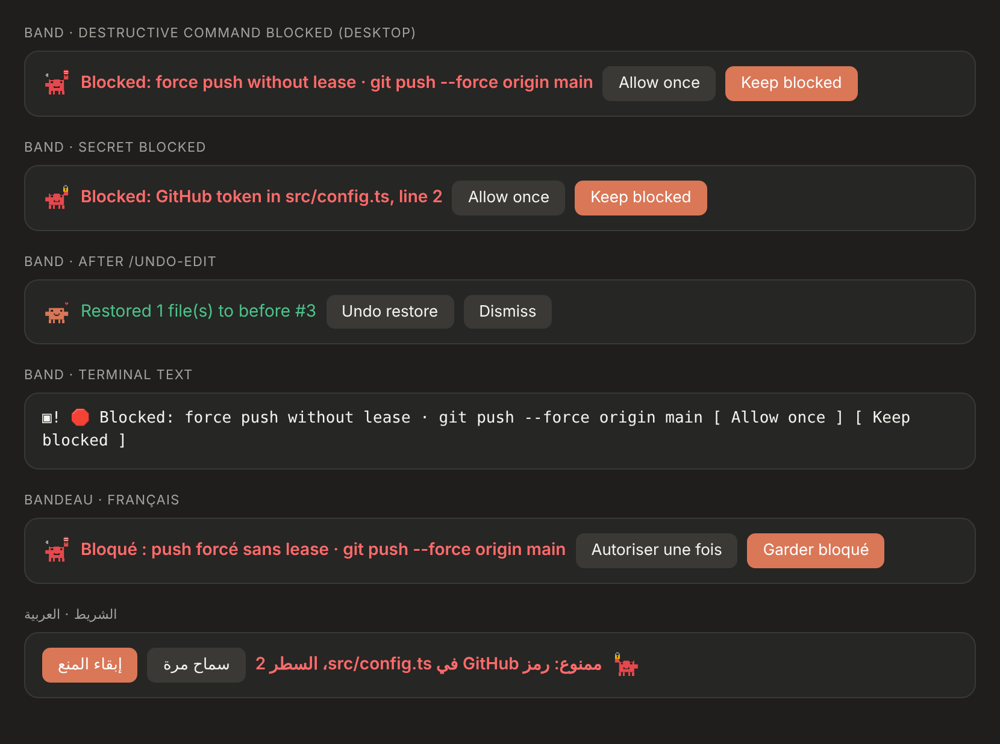
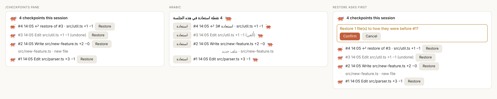

# guard

Stops Claude from destroying work or leaking keys, and saves a copy of every file before Claude edits it. Hooks only: no model calls, no network, zero tokens.




## What it does

**Danger guard** (Bash and PowerShell). Before a destructive command runs, guard asks you through Claude Code's own permission prompt. Where nobody can be asked (a background agent), it refuses the call and shows an angry-crab band with **Allow once** (lets that exact command through once, then tells Claude to retry) and **Keep blocked**.

Caught: `rm -rf` on broad paths (`/`, `~`, `.`, `..`, `*`, `.git`, `$VAR/`, system and home folders), deletes of more than N files, `find -delete`, `xargs rm`, `git push --force` without lease (and `+branch`), `git reset --hard`, `git clean -f`, `git branch -D`, `git checkout -- .`, `dd` onto a device, `mkfs`/`wipefs`, `chmod -R 777`, `curl | sh`, `bash -c "$(curl …)"`, `iwr | iex`, Windows `del /s`, `rd /s` of a broad path, `Remove-Item -Recurse -Force` of a broad path, `format C:`, `Format-Volume`, SQL `DROP DATABASE/TABLE/SCHEMA`, `TRUNCATE`, `dropdb`, `FLUSHALL`. Nested commands are read too: `bash -c`, `cmd /c`, `powershell -Command`, `-EncodedCommand`, `eval`, `$(…)`.

Never caught: read-only commands. Rules look at the program a command runs, not at its text, so `echo "rm -rf /"`, `grep "git push --force"` or `git log` pass.

**Secret guard** (Write, Edit, NotebookEdit and shell commands). Blocks real-looking Anthropic, OpenAI, GitHub, GitLab, Slack, Stripe live, AWS and Google keys, JWTs, private key blocks, passwords in URLs and `.env` secret values. The band and the refusal say the kind, file and line, never the value. Test keys (`sk-test`, `sk_test_`), documented examples (`AKIA…EXAMPLE`, jwt.io's token), placeholders (`<your-key>`, `${TOKEN}`, `xxxx`, `changeme`), `.env.example` files and dev defaults (`postgres:postgres@`) pass.

**Checkpoints.** Before every Edit, Write and NotebookEdit, and before a destructive command that names files, guard saves each file (or "did not exist") to `.claude/checkpoints/<session>/` in the project. That folder gets its own `.gitignore`.

**Band and toasts.** The band shows only while a call is blocked, or right after a restore (with **Undo restore**). Everything else is a toast. Desktop and mobile draw pixel crabs (SVG). The terminal shows the same as text. English, French and Arabic (right to left).

## Commands

- `/undo-edit`: restores the files of the last change. Run it again to go one more change back. Each restore is itself a checkpoint, so it can be undone. (`/undo` is a built-in Claude Code command, so it cannot be reused.)
- `/checkpoints`: shows or hides the timeline pane. One crab per change, with file, time and +/− lines. **Restore** buttons per change and per file; each asks for confirmation first.

## Settings

| Setting | Default | Meaning |
| --- | --- | --- |
| `dangerGuard` | on | Ask before destructive commands |
| `secretGuard` | on | Block secrets |
| `checkpoints` | on | Snapshot files before edits |
| `allowList` | empty | Comma-separated command prefixes to let through, or `re:<regex>` |
| `secretAllowPaths` | empty | Comma-separated globs the secret guard skips (e.g. `tests/fixtures/**`) |
| `maxFiles` | 20 | More files than this in one delete is a bulk delete |
| `maxFileKB` | 512 | Bigger files are listed but not saved |
| `maxCheckpoints` | 100 | The oldest checkpoints are overwritten past this |
| `maxSnapshotFiles` | 200 | Most files one checkpoint saves |
| `language` | auto | `auto`, `en`, `fr`, `ar` |

## Limits

- Restoring a file that a change created deletes it through the Bash tool, so your permission rules apply. If that is refused, the file is emptied instead.
- `git reset --hard`, `git clean` and `find -delete` name no files, so they get no checkpoint. Use git's own reflog for those.
- Checkpoints save text files only; binary and oversized files are listed as not saved. Calls run on another machine (`_host`) are not checkpointed.
- The shell reader is a best-effort parser, not a full shell. A command it cannot read is passed to Claude Code's own permission check.
- After you allow a secret, later checkpoints of that file hold a copy of it in `.claude/checkpoints/` (git-ignored, local only).

## Install

```
/plugin marketplace add Idriss-Mokdadi/claude-mods
/plugin install guard@claude-mods
```

## Tests

`claude plugin test plugins/guard`: 170 tests. Danger rules on Linux, PowerShell and cmd (blocked and allowed), every secret kind and the false positives, Allow once and Keep blocked, checkpoints, `/undo-edit`, the pane's restores, caps, languages, and checks that no secret value reaches a toast, band, refusal, prompt, log or checkpoint file. Test keys are generated at run time; none is stored in the repository.
