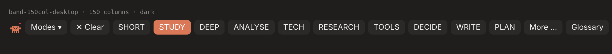
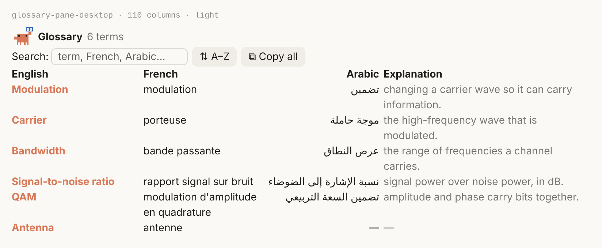
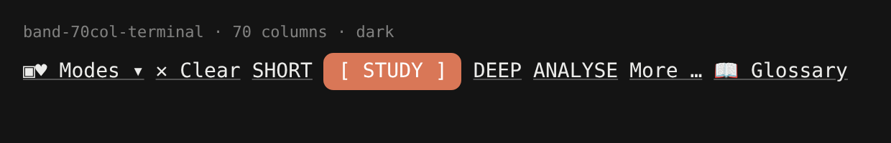
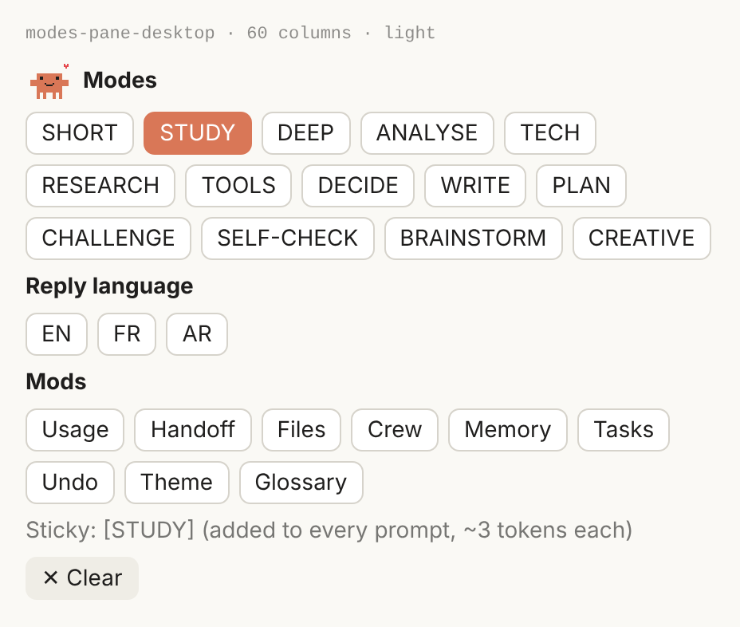
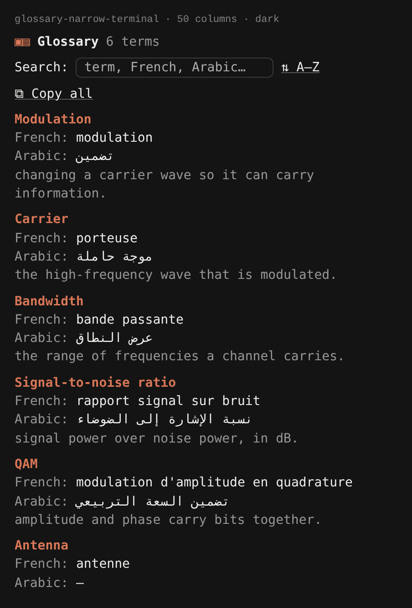

# launcher

One compact row above the prompt: your answer modes, the reply language, shortcuts to your other mods, and a Glossary pane. **Zero tokens by itself** (no model calls; sticky mode adds ~3 tokens per prompt, see below).




## What it does

- **Modes bar.** SHORT, STUDY, DEEP, ANALYSE, TECH, RESEARCH, TOOLS, DECIDE, WRITE, PLAN, CHALLENGE, SELF-CHECK, BRAINSTORM, CREATIVE. A button puts `[STUDY] ` at the start of the prompt box; press another to combine (`[STUDY] [DEEP] `), press again to remove. Your draft and cursor stay.
- **Reply language.** EN / FR / AR insert `Reply in English.` / `Reply in French.` / `Reply in Arabic.` after the mode tags; one at a time.
- **No prompt box** (a dialog is open): the tag is copied to the clipboard and a toast says so.
- **Mod shortcuts.** Usage (`/usage-panel`), Handoff (`/handoff`), Files (`/tree`), Crew (`/crew`), Memory (`/memory-list`), Tasks (`/tasks` or `/taskboard`), Undo (`/undo-edit`), Theme (`/theme` or `/lagoon`). Each shows only when another mod serves that command; Claude Code's own `/tasks` and `/theme` do not count. Rechecked at start and after each turn.
- **Glossary.** Side button or `/glossary`. Lists every term the assistant wrote in this chat in the STUDY format `**Term** (FR: … | AR: …) — explanation` (also `:` or `-` before the explanation, or none; FR or AR alone). Columns English, French, Arabic (right to left), Explanation; cards on a narrow pane. One entry per term (case, accents and punctuation ignored): the first mention wins, later ones fill a missing French, Arabic or explanation. Search box, A–Z or order seen, Copy all as a Markdown table. Pure parsing, refreshed after each turn. Your own messages and code blocks are ignored.
- **Fits one row.** The band never wraps: what does not fit goes behind **More …**, which opens the Modes pane. `Modes ▾` collapses the band to a single `Modes ▸` button (remembered across sessions).

## Commands

| Command | What it does |
|---|---|
| `/modes` | Show or hide the Modes pane (all modes, languages, shortcuts, sticky state) |
| `/glossary` | Show or hide the Glossary pane |

## Settings (`/config`)

| Setting | Default | Meaning |
|---|---|---|
| Sticky mode | off | When on, a mode or language button does not touch the box: it joins a sticky set that goes in front of **every prompt you send** until you press **✕ Clear**. Costs about 3 tokens per prompt. Not added to slash commands, to tags you already typed, or to text you did not type (task notifications, other agents). |
| Language | auto | UI text: auto (Claude Code language, then system locale), en, fr, ar (right to left). |

## Surfaces

- **Desktop:** pixel crab and buttons (screenshots above). 
- **Mobile:** the band is `Modes` and `Glossary`; each opens its pane (`/modes`, `/glossary`).
- **Terminal:** the same as text; the crab is `▣`.





## Limits

- Tags are the owner's format (`[MODE]` and `Reply in X.`); other bracket text at the start of the prompt is left alone.
- The glossary reads only `**Term** (FR/AR …)` lines; a term written another way is not listed. No flashcards.
- Arabic is shown right to left with Unicode isolates; terminals without bidi support show it in logical order.
- Button widths are estimated, so a desktop band may move one more button to More than strictly needed.
- Screenshots are drawn from the mod's real trees by a small HTML renderer, not taken from the app.

## Install

```
/plugin marketplace add Idriss-Mokdadi/claude-mods
/plugin install launcher@claude-mods
```

## Develop

```
claude plugin validate plugins/launcher
claude plugin test plugins/launcher
```

License: MIT. Crab art: see `THIRD_PARTY_NOTICES.md`.
