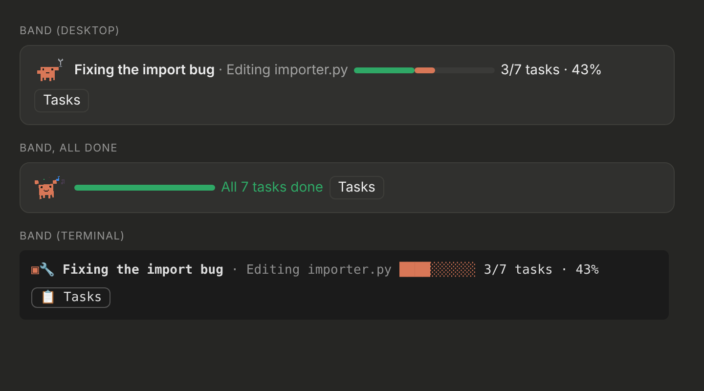
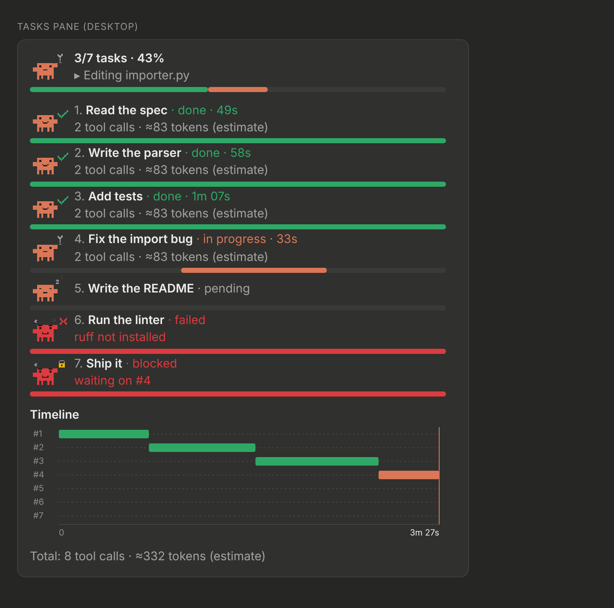

# taskboard

Shows what Claude is working on, live, in the crab style of cockpit. Hooks only: no model calls, zero extra tokens.




## Install

```
/plugin marketplace add Idriss-Mokdadi/claude-mods
/plugin install taskboard@claude-mods
```

## What it shows

- **Band** (above the prompt, only while a task list exists): a working crab, the current task, the live activity, a bar `3/7 tasks · 43%` and a **Tasks** button.
- **Tasks pane** (the button, or `/tasks`): one row per task, with a crab per state:
  - pending: sleeping crab, grey bar;
  - in progress: crab holding the prop of the tool it uses now (wrench = Edit/Write, magnifier = Read/Grep/Glob, terminal = Bash, antenna = web and MCP), moving bar, elapsed time, last tool error if any;
  - done: happy crab with a check, green bar, time taken;
  - failed or blocked: angry red crab, red bar and the reason.
- **Activity line**: "Reading parser.py", "Editing api.ts", "Running npm test", "Searching the web".
- **Timeline**: a mini Gantt, one bar per task from start to end (SVG on desktop and mobile, text in the terminal).
- **Per-task estimate**: tool calls and estimated tokens (4 characters per token, labelled "estimate").
- **All done**: the band's crab dances. (The Companion mod plays the big celebration.)
- Subagent tasks in their own group (setting).

## Where the data comes from

The task tools seen through `tool.call`: `TaskCreate`, `TaskUpdate`, `TaskList` and `TodoWrite`. Every other tool call feeds the activity line and the running task's counts. A task is:

- **failed** when Claude sets `metadata: { failed: "why" }` (or `error`) on `TaskUpdate`;
- **blocked** when it waits on an open task (`addBlockedBy`) or has `metadata: { blocked: "why" }`.

## Commands

- `/tasks`: show or hide the Tasks pane. If a Claude Code build keeps `/tasks` for itself, use `/taskboard`.

## Settings

| Setting | Default | What it does |
| --- | --- | --- |
| `language` | auto | `en`, `fr` or `ar` (right to left); auto follows Claude Code's language, then the locale |
| `subagentTasks` | on | List subagent tasks in their own group |
| `showTimeline` | on | Show the timeline chart in the pane |

## Limits

- Token counts are estimates from the size of each call's input and result, not billed usage.
- Times start when the mod sees the status change; a list made before the mod loaded is picked up at the next `TaskList` call, without past times.
- The task tools have no "failed" status: failure needs Claude to set the metadata above.
- Motion stops under `prefers-reduced-motion`.

## Development

```
claude plugin validate plugins/taskboard
claude plugin test plugins/taskboard
```

Screenshots in `docs/` are the drawn trees of the tests, rendered in Chromium (dark and light).
